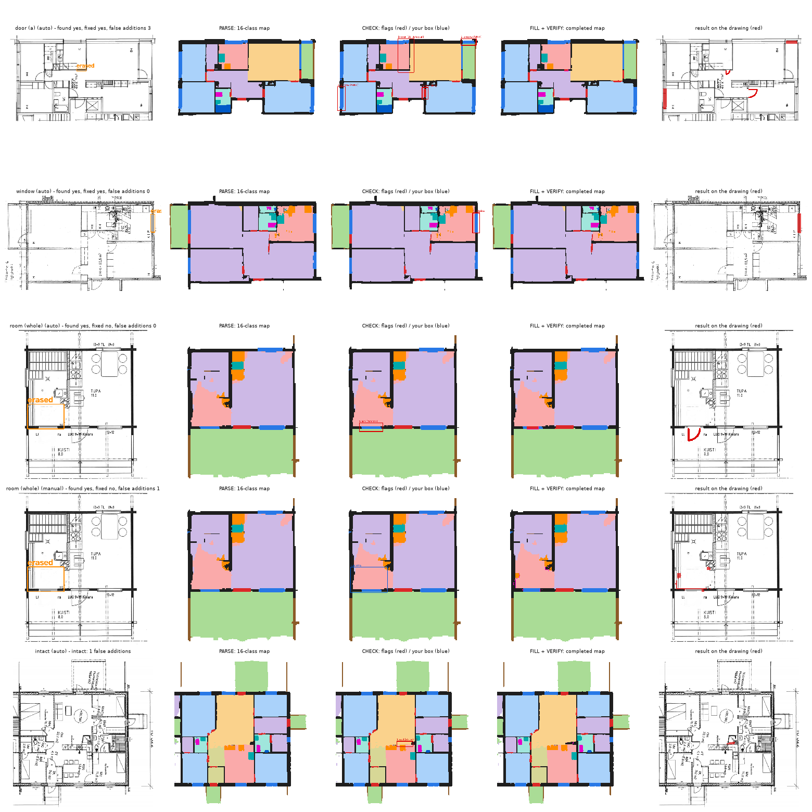

# Diffusion-Based Reconstruction of Missing Floor Plan Components

IE 643 (Deep Learning: Theory and Practice), IIT Bombay — course project, 2026 · Team **One Hot Mencoding**.

*Allotted task:* an engineer or architect may unknowingly miss a floor plan component while drawing; develop a
diffusion-based reconstruction model to correct it.

Floor plans in practice are often incomplete: a door is left out of a drawing, a wall segment is missing, a room
was never finished. This project reconstructs such missing components with **diffusion models plus explicit
structural (architectural) constraints**, in two stages:

| | Stage 1 (before the prep review) | Stage 2 (after the prep review) |
|---|---|---|
| input | a clean 128 × 128 plan map (ResPlan) + a **given** mask of the region to repair | a real black-and-white **drawing** (CubiCasa5K, or any uploaded image), nothing given |
| classes | 6: wall, door, window, room, outdoor, background | 16: wall, door, window, railing, 6 room types, outdoor, background, 4 fixture types |
| task | redraw the masked region | **find** what is missing, then draw it |
| method | U-Net sketch → re-noised to t₀ → constraint-fine-tuned diffusion (size-adaptive t₀) | PARSE → CHECK → FILL → VERIFY (segmentation network, rules + learned detectors, 16-class hybrid diffusion, best-of-N verifier) |
| result | **test** (run once): tolerant mIoU 0.846, architectural validity 88.0%, connectivity error 0.011 | see [Results](#results-at-a-glance); test notebook prepared, run once at the end |

Both stages run in one **Gradio app** (`python app/app.py`): Stage 1 with a mouse-drawn or random mask, Stage 2
with the intermediate steps (parsed map, what was flagged, the filled plan, additions in red on the drawing) and a
manual mode where you point at the missing region yourself.



*Stage 2 on the first gallery drawing of each kind (held-out val, no picking): an erased door (found, fixed), an erased window (the parser had already redrawn it), a whole room erased (flagged only as a missing door, not fixed; manual mode does not fix it either), and an intact drawing (one false addition). Made by `python -m src.stage2.interface.make_step_figures`.*

## Deliverables checklist (IE 643 allotment)

| expected deliverable | where it is |
|---|---|
| 1. Floor plan dataset + controlled missing-component generation (walls, doors, windows, rooms, other elements) | Stage 1: ResPlan → 128 × 128 maps, near-duplicate-aware split (`src/stage1/data/`, `docs/data_notes.md`); corruption by **type** (door, window, wall segment, room, region), **location** (interior / exterior), **position** (centre / edge) and **size** (small / medium / large) with a mask that never reveals the shape (`src/stage1/data/corruptions.py`); fixed val / test benchmarks. Stage 2: CubiCasa5K drawings, 16 classes, omissions erased **on the drawing itself** — door (2 kinds), window, wall, railing, fixture, a room's walls, a whole room, a region — with the same metadata (`src/stage2/data/erasure*.py`, `omission_meta.py`) |
| 2. Diffusion-based reconstruction that preserves the surrounding structure | Palette-style x0-prediction diffusion, the known region reset at every DDIM step; hybrid: U-Net sketch → re-noised to t₀ → diffusion (`src/stage1/models/diffusion.py`, `src/stage1/sampling_experiment.py`; 16-class version `src/stage2/complete/`) |
| 3. Structure-aware reconstruction (wall connectivity, room boundaries, alignment, consistency) | constraint losses: soft clDice (connectivity) + room closure in Stage 1; library C1–C18 + rules R1–R4 in Stage 2 (connectivity, closure, openings in walls, wall alignment C5, door adjacency, …) used as training losses, detector inputs and the best-of-N verifier (`src/stage1/models/constraints.py`, `src/stage2/constraints/`, `docs/constraints_spec.md`); weights calibrated by gradient size |
| 4. Component-level evaluation | per-class and tolerant IoU, **component detection precision / recall / F1** (Hungarian matching, IoU ≥ 0.5) for doors, windows, rooms, connectivity error, room leak, alignment, architectural validity (`src/stage1/eval/`); Stage 2: parser component F1, CHECK found / right type per component kind, end-to-end found / fixed / false additions (`docs/results.md`) |
| 5. Robustness + ablation | results by type, location, position and hole size (`outputs/stage1/stage1_test.md`, `full_eval.md`; Stage 2 breakdowns in every evaluation and the final test); ablations: constrained vs control diffusion (Stage 1 `finetune_ablation.md`, `selection.md`; Stage 2 in the final test), U-Net vs hybrid, t₀, guidance, each CHECK part, large-hole models (`docs/results.md` §3) |
| Trained models + code + documentation + dependencies | code and docs in this repo, `requirements.txt` (tested versions); checkpoints: see [Trained models](#trained-models) |
| An interface to upload inputs and test the method | `python app/app.py`: Stage 1 (pick / draw / upload a plan, brush or random mask) and Stage 2 (pick or **upload any drawing**; every step shown; manual mode) — `docs/interface.md` |
| A performance metric + qualitative results | the app scores every repair against the truth when it is known and shows the step pictures; the "How it works · results" tab lists the metrics; `docs/results.md`, `outputs/stage2/pipeline_steps.png` |
| Stage-wise report (reasons, experiments, datasets, extraction, interface methodology) | written by the team; material mapped in `docs/report_guide.md`; every choice and its reason in `docs/decisions.md` |

## Results at a glance

Every number below comes from a file in `outputs/`; `docs/results.md` has the full step-by-step tables, the source
of each number, and the honest weak spots.

**Stage 1 — ResPlan, mask given, TEST set (7,774 cases, run once with settings frozen on val)** —
`outputs/stage1/stage1_test.md`

| method | tolerant mIoU | validity | connectivity error | door / window / room F1 |
|---|---|---|---|---|
| **size-adaptive hybrid (final)** | 0.846 | **88.0%** | **0.011** | 0.752 / 0.731 / 0.972 |
| matched U-Net (no diffusion) | **0.850** | 81.0% | 0.085 | 0.711 / 0.706 / 0.966 |
| nearest-class fill (baseline) | 0.493 | 36.6% | 0.064 | 0.466 / 0.466 / 0.701 |

The hybrid gives up 0.4 points of pixel accuracy for clearly more plausible structure (paired bootstrap on test:
validity +7.1 points, connectivity error −0.074, both significant).

**Stage 2 — real CubiCasa5K drawings, VALIDATION** (the one-shot test run is the project's last step:
`docs/final_test_notebook.md`)

| step | what is measured | result (val) | file |
|---|---|---|---|
| PARSE | 16-class mIoU on 159 held-out drawings; door / window component F1 | 70.1; 79.5 / 77.3 | `outputs/stage2/parser_v2.md` |
| CHECK | omissions found / false alarms per intact drawing (held-out, nearest config) | 60% / 0.59 | `outputs/stage2/detection_eval.md` |
| FILL (hole given) | small holes: tolerant mIoU, fixed; large holes (B4) | 69.2, 25/30; 49.3, 29/30 | `outputs/stage2/b4_val.md` |
| END TO END | 12 fresh drawings, one small omission each: found / fixed / false additions | 9 / 8 / 5 | `outputs/stage2/e2e_val_batch2_b4.md` |

Weak spots, stated plainly: false alarms roughly double from tuning to held-out drawings; large omissions (a whole
room) are not detected automatically (manual mode only); many "fixed" omissions are symbols the parser redrew,
not the fill; the constraint losses give no measurable gain in Stage 1 and a small one in Stage 2. Details:
`docs/results.md`.

## Repository map

```
app/                 the Gradio app (UI only): app.py, ABOUT.md (the app's "how it works" tab)
src/
  stage1/            Stage 1: data/ (ResPlan -> 6-class maps, dedup, split, corruptions), models/ (U-Net,
                     diffusion, constraint losses), eval/ (metrics), interface/ (app logic), train.py, evaluate.py,
                     full_eval.py, arch_eval.py, selection.py, stats.py, ...
  stage2/            Stage 2: data/ (CubiCasa5K -> 16-class maps, erasure), constraints/ (C1-C18 library),
                     parse/ (parser), detect/ (CHECK), complete/ (FILL + VERIFY), pipeline/ (run.py = the
                     end-to-end method), interface/ (app logic), final_test.py
  utils.py, distributed.py, kaggle_prep.py, kaggle_kernel.py     shared helpers
configs/stage1/, configs/stage2/   every setting (YAML); final settings are marked in the files
tests/stage1/, tests/stage2/       unit tests:  python -m pytest tests/
kaggle/kernels/stage1/, kaggle/kernels/stage2/, kaggle/notebooks/   how each model was trained on Kaggle GPUs
outputs/stage1/, outputs/stage2/   result tables (.md / .csv) and figures (.png); outputs/stage2/history/ = superseded
docs/                decisions log, results, code walkthrough, data notes, constraint spec, Kaggle workflow
```

Each folder has a README (`src/stage2/README.md`, `outputs/README.md`, `kaggle/README.md`, `docs/README.md`).

## Quick start

```bash
conda create -n floorplan python=3.11
conda activate floorplan
pip install -r requirements.txt
python -m pytest tests/                       # 246 tests, about 1 minute on a laptop
python app/app.py                             # http://127.0.0.1:7860  (needs the checkpoints, see below)
```

Stage 2 from Python:

```python
import cv2
from src.stage2.pipeline.run import run_pipeline
drawing = cv2.imread("my_plan.png", cv2.IMREAD_GRAYSCALE)      # 0 = ink, 255 = paper, any size
result = run_pipeline(drawing, fast=True)                      # PARSE -> CHECK -> FILL -> VERIFY
print(result["messages"])                                      # e.g. "bedroom had no door -> door added ..."
cv2.imwrite("result.png", result["overlay"][..., ::-1])        # additions in red on the drawing
result = run_pipeline(drawing, boxes=[(120, 300, 220, 420)])   # manual: fill this box (y0, x0, y1, x1)
```

Runs on a CPU (about 1–2 minutes per drawing on a laptop) or a GPU (`STAGE2_DEVICE=cuda`).

## Data

- **ResPlan** (Stage 1; [github.com/m-agour/ResPlan](https://github.com/m-agour/ResPlan)): about 17,000 vector
  residential plans. We exclude the 683 "augmented" copies, remove near-duplicates (structure cosine, then
  tolerant IoU ≥ 0.90), and make our own 80/10/10 split in which similar plans never cross splits (12,446 /
  1,556 / 1,556). Corruptions (door, window, wall segment, room, region) are made in a controlled way by type,
  location and size; fixed benchmarks: 7,772 val / 7,774 test cases. Build: `python -m src.stage1.data.build_dataset`,
  `python -m src.stage1.data.make_benchmark`; details `docs/data_notes.md`.
- **CubiCasa5K** (Stage 2; Kaggle mirror `qmarva/cubicasa5k`, CC BY-NC 4.0; Kalervo et al., 2019): 5,000 real
  floor plan drawings with SVG annotations. Official train / val / test split; val is further split into 212
  *tuning* and 159 *held-out* drawings (`configs/stage2/val_split/`). Each SVG is rasterised twice: a parser set
  (drawing + labels, walls ~8 px) and a completion set (labels, walls ~3 px). Omissions are simulated on the
  drawing itself (`src/stage2/data/erasure.py`). Built on Kaggle: `kaggle/kernels/stage2/stage2_data/`.
- Data files are not in git (`data/` is ignored).

## Trained models

Checkpoints are not in git (1.6 GB). They are the outputs of the Kaggle kernels in `kaggle/kernels/` and are
bundled, with the offline install files, in the Kaggle dataset `venkatesh007c/floorplan-stage2-final`
(`python -m src.stage2.package_final` builds it; it is uploaded together with the final test run and shared with
the instructor and TAs). To use them, download the dataset and copy its `checkpoints/` folder into the project
folder: every file lands at the path the code expects. Paths expected by the code:

| model | config | checkpoint path (local) |
|---|---|---|
| Stage 1 matched U-Net (sketch) | `configs/stage1/train_unet_matched.yaml` | `outputs/runs/unet_matched/checkpoints/best.pt` |
| Stage 1 constraint fine-tuned diffusion | `configs/stage1/finetune_constraints.yaml` | `outputs/kaggle/finetune_constraints/runs/finetune_constraints/checkpoints/best.pt` |
| Stage 2 parser v2B (ResNet-34 U-Net) | `configs/stage2/parser_v2.yaml` | `outputs/kaggle/parser_v2/runs/parser_v2B/checkpoints/best.pt` |
| Stage 2 detectors v2, v3 | `configs/stage2/detector_v2.yaml`, `detector_v3.yaml` | `outputs/kaggle/detv2/...`, `outputs/kaggle/detv3/...` |
| Stage 2 16-class U-Net, constrained / control diffusion | `configs/stage2/train16_*.yaml` | `outputs/kaggle/k2a/...`, `outputs/kaggle/k1/...` |
| Stage 2 large-hole models (B4) | `configs/stage2/train16_b4_*.yaml` | `outputs/kaggle/b4/...` |

The full list is `configs/stage2/pipeline.yaml` (`checkpoints:`) and `configs/stage1/app.yaml`.

## Reproducing

| step | command | where |
|---|---|---|
| Stage 1 data + benchmarks | `python -m src.stage1.data.build_dataset --reuse-split`, `python -m src.stage1.data.make_benchmark` | laptop |
| Stage 1 training | `python -m src.stage1.train --config configs/stage1/<name>.yaml --out <run dir>` | Kaggle T4 × 2 (`kaggle/kernels/stage1/`) |
| Stage 1 evaluation + selection | `python -m src.stage1.full_eval`, `arch_eval`, `stats`, `selection` | Kaggle (predictions) + laptop (scoring) |
| Stage 2 data | `python -m src.stage2.data.build_cubicasa` | Kaggle CPU (`kaggle/kernels/stage2/stage2_data/`) |
| Stage 2 training | parser `src.stage2.parse.train` / `train_v2`; detectors `src.stage2.detect.train_detector_v2` / `_v3`; fill `src.stage2.complete.train16` | Kaggle GPU (`kaggle/kernels/stage2/`) |
| Stage 2 validation | `python -m src.stage2.pipeline.e2e_val --zip parser_val.zip`, `src.stage2.detect.check_tune`, `src.stage2.complete.b4_val` | laptop / Kaggle CPU |
| Stage 2 test (once) | `kaggle/notebooks/stage2_final_test/` | Kaggle T4 × 2 (`docs/final_test_notebook.md`) |

How to train on Kaggle (upload code, launch, resume, download): `docs/kaggle_workflow.md`.

## Code walkthrough

`docs/code_walkthrough.md` maps every topic the walkthrough must cover — data collection, preprocessing, splits,
networks, loss functions, optimizer, learning rate and schedule, training loop, metrics, validation — to the exact
file and lines.

## Documentation

| file | what it is |
|---|---|
| `docs/results.md` | all final numbers, step by step, with sources and weak spots |
| `docs/decisions.md` | every choice made in the project and why (chronological log; final configuration at the top) |
| `docs/code_walkthrough.md` | topic → file:line map (and a 10-minute plan) |
| `docs/stage1_summary.md` | Stage 1 in one page |
| `docs/constraints_spec.md` | the structural constraints C1–C18 (original specification) |
| `docs/data_notes.md` | Stage 1 data pipeline and benchmarks |
| `docs/interface.md` | the Gradio app: design, tests, timing |
| `docs/kaggle_workflow.md` | training on Kaggle |
| `docs/final_test_notebook.md` | the one-shot Stage 2 test |

## Acknowledgements and licences

ResPlan (m-agour/ResPlan) and CubiCasa5K (Kalervo et al., CC BY-NC 4.0) data; Hugging Face `diffusers`
(UNet2DModel, DDIM scheduler) and `segmentation-models-pytorch` (ResNet-34 U-Net). The project was developed with
the help of an AI coding assistant (Claude Code); `CLAUDE.md` is its working context, and `docs/decisions.md`
records which choices were the student's and which were proposed.
